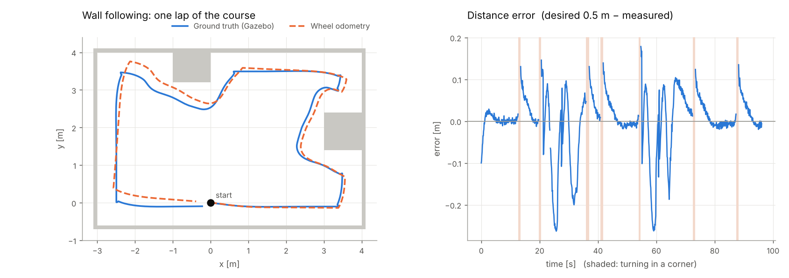
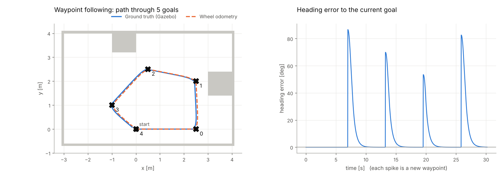
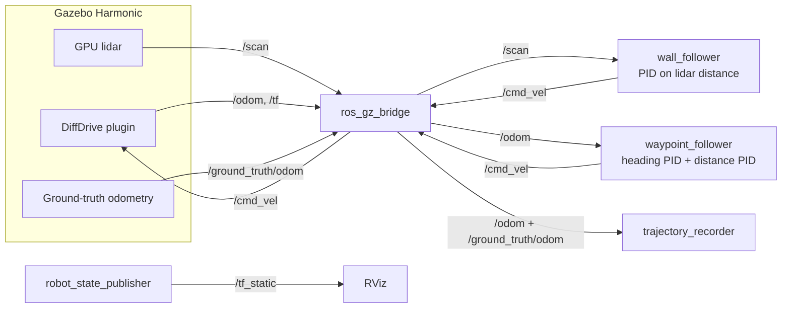

# ROS 2 PID Diff-Drive Robot (Gazebo)

A two-wheeled differential-drive robot in **Gazebo Harmonic** that **follows walls with a lidar** and **drives to waypoints with odometry**. The motion controllers use a **PID controller I wrote from scratch**, with no control library. Everything runs in **Docker**, so the whole simulation starts with one command on any Linux machine.


[](../../actions/workflows/ci.yml)


---

## What this project shows

| Skill | Where it shows up |
|---|---|
| **ROS 2** (rclpy, launch, parameters, QoS, TF) | Two controller nodes, a trajectory recorder, launch files with arguments, parameters you can change live at runtime |
| **Control engineering** | PID with anti-windup, a filtered derivative and output saturation, plus look-ahead wall geometry and coupled heading/distance loops |
| **Gazebo simulation** | URDF/xacro robot with DiffDrive, a GPU lidar, a ground-truth odometry plugin, a custom SDF world and a `ros_gz_bridge` config |
| **Sensors and state estimation** | Lidar beam geometry; wheel odometry measured against simulator ground truth (drift analysis) |
| **Testing** | 33 pytest tests, including closed-loop tests on a 2D kinematic simulator with ray-cast lidar, plus flake8 via `colcon test` |
| **Linux, Docker, CI** | Reproducible Docker image, headless simulation, a Makefile, GitHub Actions build and test |

## Results (from a headless Gazebo run)

**Wall following:** one lap of a course with straight walls plus inside and outside corners takes 96 s, and the robot never touches a wall (its centre stays at least 0.37 m from every wall).



| Metric (target distance 0.50 m) | Value |
|---|---|
| Median distance error while following | **2.5 cm** |
| RMS distance error while following | 7.4 cm |
| 90th percentile error | 11.8 cm (the peaks come right after corners) |

**Waypoint following:** visits 5 waypoints and returns to the start in **31 s** (30.7 s), stopping at the 12 cm goal tolerance.



**Odometry drift:** wheel odometry (dashed orange) matches ground truth on the smooth waypoint path. After a full wall-following lap with many in-place turns, it is **0.21 m and 5° off**. That gap is the reason the next step is sensor fusion (see [Next steps](#next-steps)).

---

## Quick start

Requirements: Docker (and an X server if you want the GUI).

```bash
git clone <this repo> && cd ros2-pid-diffbot
make build          # ROS 2 Jazzy + Gazebo Harmonic + this workspace (first build downloads ~3 GB)
make test           # 33 unit/closed-loop tests + lint
make wall           # headless wall-following run, logs to ./logs
make waypoints      # headless waypoint run, logs to ./logs
make plots          # regenerate the figures above from ./logs
```

### With the Gazebo GUI and RViz (Linux host)

```bash
xhost +local:docker
docker compose run --rm sim ros2 launch diffbot_control wall_follow.launch.py rviz:=true
docker compose run --rm sim ros2 launch diffbot_control waypoints.launch.py rviz:=true
```

### Without Docker (Ubuntu 24.04 + ROS 2 Jazzy installed)

```bash
mkdir -p ~/ws/src && cd ~/ws/src && git clone <this repo>
cd ~/ws && rosdep install --from-paths src --ignore-src -y
colcon build && source install/setup.bash
ros2 launch diffbot_control wall_follow.launch.py
```

### Tune gains live

```bash
ros2 param set /wall_follower kp 3.0
ros2 param set /wall_follower desired_distance 0.7
ros2 run rqt_plot rqt_plot /wall_follower/error
```

---

## Architecture



Only one controller runs at a time; each launch file starts the simulation plus one controller.

```
ros2-pid-diffbot/
├── diffbot_sim/                     # ament_cmake: robot model + world + sim launch
│   ├── urdf/diffbot.urdf.xacro      # chassis, 2 wheels, caster, lidar, Gazebo plugins
│   ├── worlds/wall_course.sdf       # 7 m x 4.6 m room with two notches
│   ├── config/ros_gz_bridge.yaml    # Gazebo <-> ROS 2 topic mapping
│   └── launch/sim.launch.py         # Gazebo + spawn + bridge (+ RViz), headless option
├── diffbot_control/                 # ament_python: the controllers
│   ├── diffbot_control/
│   │   ├── pid.py                   # ⭐ the PID controller (no ROS dependency)
│   │   ├── wall_follow_logic.py     # wall geometry + control law (no ROS dependency)
│   │   ├── waypoint_logic.py        # go-to-goal law (no ROS dependency)
│   │   ├── wall_follower_node.py    # thin ROS 2 wrapper
│   │   ├── waypoint_follower_node.py
│   │   └── trajectory_recorder_node.py
│   ├── config/*.yaml                # tuned parameters
│   ├── launch/*.launch.py
│   └── test/                        # pytest: PID, geometry, closed-loop 2D sim
├── scripts/                         # plotting, GIF, odometry check
├── Dockerfile, docker-compose.yml, Makefile
└── .github/workflows/ci.yml
```

**Design choice:** the control logic (`pid.py`, `*_logic.py`) is plain Python with no ROS imports. The ROS nodes only convert messages. That keeps the controllers unit-testable in milliseconds and reusable on real hardware.

---

## PID design

`diffbot_control/pid.py` implements

$$u = K_p e + \underbrace{\textstyle\sum K_i e\,\Delta t}_{\text{integral term}} + K_d \frac{de}{dt}$$

with four additions a textbook PID leaves out, each covered by a test in `test/test_pid.py`:

1. **Output saturation.** The output is clamped to what the robot can do (for example ±1.5 rad/s).
2. **Anti-windup by conditional integration.** While the output is saturated and the error would push it further, the integrator is frozen. Without this, the integral keeps growing during long turns and causes a large overshoot afterwards. `test_anti_windup_limits_overshoot` shows the difference: 4 % overshoot with it, 15 % without.
3. **Low-pass filtered derivative.** Lidar ranges are noisy, and differentiating noise amplifies it. A first-order filter with time constant τ smooths the D term: `d_f += dt/(τ+dt) · (d_raw − d_f)`.
4. **No derivative kick.** On the first sample (or after `reset()`) there is no previous error, so D is zero instead of a spike. Controllers call `reset()` when they switch modes or waypoints, so old integral and derivative state doesn't carry over.

The integral is stored already multiplied by `Ki` (the "integral term"), so its clamp limits are in output units, which are easier to reason about.

### Wall follower (`wall_follow_logic.py`)

Two lidar beams hit the wall on the followed side: `b` at 90° and `a` at 90° − θ (θ = 50°). From them:

```
alpha    = atan2(a·cos θ − b, a·sin θ)      # angle between heading and wall
D        = b · cos(alpha)                    # perpendicular distance
D_future = D + L · sin(alpha)                # distance after driving L = 0.4 m
error    = desired − min(D_future, side_min + 5 cm)
omega    = −side · PID(error)
v        = v_max / (1 + 2|error|), slowed further when a wall is ahead
```

* **Look-ahead (`D_future`)** makes the controller react to the robot's *angle* to the wall, not only its distance. This adds a lot of damping: on its own, a P-only controller on `D` keeps weaving (see the tuning notes).
* **`side_min` safety net:** the two-beam estimate assumes one straight wall, so around an outside corner it cuts in. Taking the closest return in a ±50° sector around the side (plus a 5 cm margin, because the minimum of ~100 noisy beams is biased low) fixed a corner clip that I found in Gazebo (see [Debugging story](#debugging-story)).
* **Behaviour modes:** `corner` (wall ahead: turn in place, with hysteresis so it doesn't chatter) and `search` (wall lost: arc around the corner at radius = desired distance).

### Waypoint follower (`waypoint_logic.py`)

* Heading loop: `e_θ = wrap(atan2(Δy, Δx) − yaw)` → PID → angular velocity
* Distance loop: `e_d = ‖goal − pose‖` → PID → linear velocity, **scaled by `max(0, cos e_θ)`**

The cosine coupling makes the robot turn first and drive second. Without it, two independent PIDs drive in wide spirals around the goal.

---

## PID tuning notes

**1. Look-ahead before gains.** In the 2D test simulator (`test/sim_helpers.py`, starting 0.25 m off the target, P-only, Kp = 2.5):

| Look-ahead L | Overshoot | Settles to ±3 cm in | Steady offset |
|---|---|---|---|
| 0 m (plain distance PID) | 12 cm | never (keeps weaving) | 5 cm |
| 0.2 m | 6 cm | 7.7 s | 0 |
| **0.4 m** | 2 cm | **3.3 s** | 0 |

The look-ahead adds the damping that a D term would normally give, without differentiating a noisy lidar signal.

**2. Then the gains, in Gazebo.** Each row is a headless run of the same course, scored on the controller's own log. "Steering jitter" is the mean change in commanded angular velocity per scan (rad/s), which is a proxy for motor wear and wobble.

| Kp | Ki | Kd | RMS error | 90th pct error | Steering jitter | Closest to wall |
|---|---|---|---|---|---|---|
| 2.5 | 0 | 0 | 7.7 cm | 11.5 cm | 0.038 | 0.36 m |
| 2.5 | 0.1 | 0.6 | 9.9 cm | 18.1 cm | 0.108 | **0.22 m** |
| 4.0 | 0.1 | 0.6 | 7.1 cm | 12.1 cm | 0.105 | 0.32 m |
| 2.5 | 0 | 0.3 | 7.3 cm | 12.1 cm | 0.067 | 0.35 m |
| 2.5 | 0.1 | 0.3 | 7.3 cm | 11.5 cm | 0.060 | 0.36 m |
| 3.5 | 0.1 | 0.3 | 6.1 cm | 10.3 cm | 0.080 | 0.35 m |
| **2.5** | **0.1** | **0.15** | **6.9 cm** | **10.4 cm** | **0.050** | **0.36 m** |

_(The first four rows ran four simulations in parallel, so the simulation ran slower than real time. Treat them as indicative.)_

**Takeaways:**
* **Too much Kd hurts.** With Kd = 0.6 the 10 Hz lidar noise gets amplified, steering jitter triples, and the robot comes within 0.22 m of a wall. The look-ahead already supplies most of the damping.
* **Ki matters little here.** Its job is to remove a constant bias (for example lidar noise biasing the distance estimate), and the error is dominated by corners rather than by bias.
* **I chose Kp = 2.5, Ki = 0.1, Kd = 0.15.** Kp = 3.5 had slightly lower error but 60 % more steering jitter. On a real robot I'd rather have the smoother one.
* **Most of the remaining error comes after corners**, not on straight walls. Better corner handling would help more than more gain tuning.

| Waypoint loops | Kp | Ki | Kd | Notes |
|---|---|---|---|---|
| Heading | 3.0 | 0 | 0.3 | No Ki needed: heading has no steady-state disturbance |
| Distance | 0.8 | 0.05 | 0.1 | Output clamped to [0, 0.4] m/s; small Ki so it doesn't crawl near the goal |

To reproduce a row: `ros2 param set /wall_follower kd 0.6` while it runs, or edit `diffbot_control/config/wall_follower.yaml`, then `make wall`.

## Debugging story

The first full Gazebo run looked right in RViz, but wheel odometry suddenly jumped by **130°** relative to the simulator's ground truth. I added a ground-truth odometry plugin and a `trajectory_recorder` node to log both, and lined them up against the controller log. The jump happened while the robot was stuck against the corner of a notch. When two-beam geometry wraps around an outside corner, it overestimates the distance, so the robot cut the corner, clipped it and spun its wheels in place. The fix was the `side_min` safety distance plus corner hysteresis, and a new closed-loop test (`test_wraps_around_outside_corners_without_clipping`) reproduces the scenario. After the fix the robot keeps ≥0.36 m from every wall, and odometry error after a lap fell from ~6 m to ~0.2 m.

`scripts/odom_check.py` drives a fixed spin/straight/spin manoeuvre and prints odometry vs. ground truth. I used it to compare wheel collision shapes. With cylinder wheels the robot over-rotated by about 10 % in place, which matches the contact sitting on the wheel's inner edge (a narrower effective track). Sphere collisions get in-place turns right to within 1°.

---

## Recording a demo

1. Run with the GUI (see above) and record the screen (`SimpleScreenRecorder`, OBS, or `peek` on Linux).
2. Convert to a GIF: `ffmpeg -i demo.mp4 -vf "fps=12,scale=900:-1" docs/media/demo.gif`
3. Replace the GIF at the top of this README.

## Next steps

* **Sensor fusion:** add an IMU to the robot and fuse it with wheel odometry using an EKF (`robot_localization`), then measure the drift reduction with the same ground-truth recorder.
* **ros2_control:** replace the Gazebo DiffDrive plugin with `diff_drive_controller` so the same stack runs on real hardware.
* **Nav2:** compare my waypoint controller against Nav2's Regulated Pure Pursuit controller.

## License

MIT
